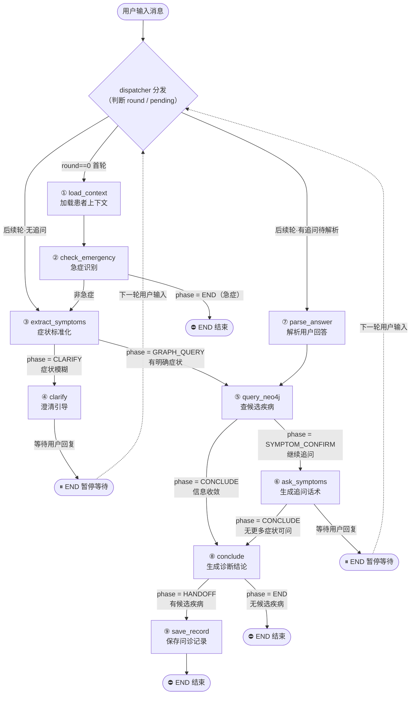

# 智慧问诊 Agent —— 枚举阶段业务流程图

> 本图对应 `src/agents/inquiry/state.py` 里的 `InquiryPhase` 枚举，
> 以及 `src/agents/inquiry/graph.py` 里的节点与路由逻辑。

## 一、7 个枚举值速查表

| 枚举值 | 中文含义 | 对应节点 | 谁"写"它（设置阶段） | 谁"读"它（路由判断） |
|--------|---------|---------|---------------------|---------------------|
| `CLARIFY` | 澄清模糊描述 | ④ clarify | extract_symptoms | route_after_extract |
| `GRAPH_QUERY` | 查知识图谱 | ⑤ query_neo4j | extract_symptoms | route_after_extract |
| `SYMPTOM_CONFIRM` | 追问候选症状 | ⑥ ask_symptoms | query_neo4j | route_after_neo4j |
| `COMPLICATION_CHECK` | 追问并发症 | （未实现） | — | — |
| `CONCLUDE` | 出诊断结论 | ⑧ conclude | query_neo4j / ask_symptoms | route_after_neo4j / route_after_ask |
| `HANDOFF` | 移交挂号 | ⑨ save_record | conclude | route_after_conclude |
| `END` | 流程结束 | 结束 | 多个节点 | route_after_emergency / route_after_conclude |

> 说明：`END` 的值是字符串 `"__end__"`，这是 LangGraph 框架的内置结束标记。

## 二、完整业务流程图（节点流转 + 阶段枚举）



## 三、两个循环（多轮对话的引擎）

### 循环① 追问循环（主循环，收敛候选疾病）

```
⑤ query_neo4j ──(SYMPTOM_CONFIRM)──► ⑥ ask_symptoms ──► ⏸ END 等待
      ▲                                                       │
      │                                                       │ 下一轮用户回答
      └──────────────── ⑦ parse_answer ◄──────────────────────┘
```

- 每次用户回答后，重新查图谱 → 追问新症状 → 再等回答。
- 直到 `check_convergence` 判定"信息够了"，`phase = CONCLUDE`，跳出循环进入 ⑧。

### 循环② 澄清循环（用户描述模糊时）

```
③ extract_symptoms ──(CLARIFY)──► ④ clarify ──► ⏸ END 等待
      ▲                                            │
      │                                            │ 下一轮用户补充
      └────────────────────────────────────────────┘
```

- 用户说不清（如"我不舒服"），一直引导澄清，直到提取到明确症状，`phase = GRAPH_QUERY`，进入 ⑤。

### 单轮 vs 多轮

- **单轮内**：①→②→③→⑤→⑥→⑧→⑨ 一条线（实线）。
- **跨轮**：⑨ 或 ⏸ 处"暂停"，等用户下一句话进来，从 dispatcher 重新入口（虚线），这就是"循环"。

## 四、InquiryState 主状态对象（黑板）通俗理解

> 详见下方"为什么要写 InquiryState"的完整讲解。
> 核心一句话：**InquiryState 是一块"问诊现场的黑板"，4 个类 + 一堆散字段是黑板上的分区，9 个节点是围着黑板干活的人。**
